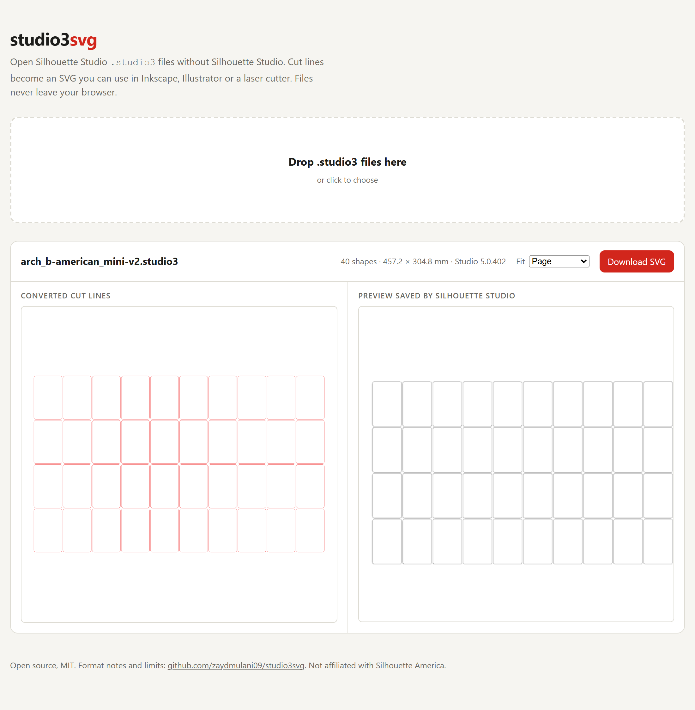

# studio3svg

Convert Silhouette Studio `.studio3` files to SVG without Silhouette Studio.

The free Basic Edition of Silhouette Studio saves designs only as `.studio3`. Exporting SVG needs
the paid Business Edition, and the usual workaround is a screenshot traced in Inkscape.
studio3svg reads the file directly and writes the cut lines as an SVG in millimetres, ready for
Inkscape, Illustrator, LightBurn or another cutter's software.

**Web app:** https://zaydmulani09.github.io/studio3svg/ (runs in your browser, files are never uploaded)



## Command line

Needs Node.js 22 or newer. No dependencies.

```bash
npx github:zaydmulani09/studio3svg design.studio3
```

or clone and run it:

```bash
git clone https://github.com/zaydmulani09/studio3svg
```

```bash
node studio3svg/bin/studio3svg.js studio3svg/test/fixtures/card-templates/a4-poker-v3.studio3
```

```
studio3svg/test/fixtures/card-templates/a4-poker-v3.studio3 -> studio3svg/test/fixtures/card-templates/a4-poker-v3.svg (8 shapes)
```

Options:

| Option | Meaning |
|---|---|
| `-o, --out <path>` | Output file, or a directory when converting several files |
| `--fit page` | SVG covers the document page (default) |
| `--fit content` | SVG is cropped to the shapes |
| `--stroke <color>` | Outline colour, default `#e00` |
| `--json` | Print the parsed document as JSON instead |
| `--thumbnail` | Also save the preview image stored in the file as `<name>.png` |

Exit status is 0 on success, 1 when a file could not be converted, 2 for bad usage.

## Library

```js
import { readFileSync } from 'node:fs';
import { parseStudio3 } from 'studio3svg';
import { toSvg } from 'studio3svg/svg';

const doc = parseStudio3(readFileSync('design.studio3'));
doc.page;   // { widthMm, heightMm }
doc.shapes; // [{ name, serial, path: { subpaths: [{ closed, points: [{ x, y, in, out }] }] }, effects }]
const svg = toSvg(doc, { fit: 'page' });
```

`parseStudio3` throws `Studio3Error` for files it cannot read. Handles (`in`, `out`) are offsets
from their point, in mm.

## What it reads

- Every cut outline: shapes, freehand lines, text (as letter outlines), shapes inside groups.
- The page size, so the SVG lines up with the mat.
- The preview image Silhouette Studio stores in each file.
- Effect settings (for example puncher holes), reported but not drawn.

Not yet: colours, line styles, layer names and visibility, raster images, editable text,
generated effect output, files older than Studio 5 format (`silhouette04;`). SPEC.md has the
full coverage matrix.

## How it was checked

- Ground truth: 7 card templates whose intended card sizes, grid and 3 mm corner radius are published
  by the generator that made them. Every card matches to 0.02 mm.
- Differential: each `.studio3` stores a preview rendered by Silhouette Studio. Decoded outlines
  must land on that preview's ink. 224 of 225 comparable files pass (TESTING.md lists the one
  that does not and why).
- Malformed input: truncation at every length and 2 000 seeded random corruptions produce either
  a clean parse or a `Studio3Error`, never a crash or hang.

## Documents

- [SPEC.md](SPEC.md): the format as far as it is understood, with confidence for each part
- [RESEARCH.md](RESEARCH.md): target choice and method
- [TESTING.md](TESTING.md): tests and how to run them on your own files
- [CHANGELOG.md](CHANGELOG.md)

## License

MIT. Test fixtures in `test/fixtures/card-templates` are from
[silhouette-card-maker](https://github.com/Alan-Cha/silhouette-card-maker) (MIT, Copyright (c) 2025 Alan Cha).

Not affiliated with or endorsed by Silhouette America. Silhouette Studio is their trademark.
